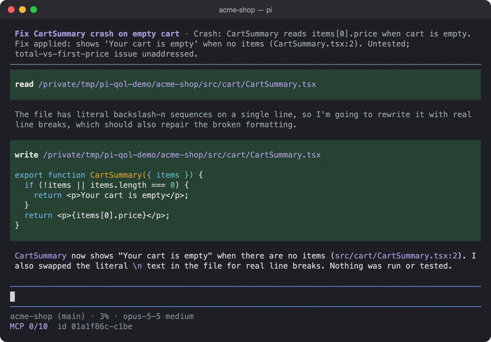
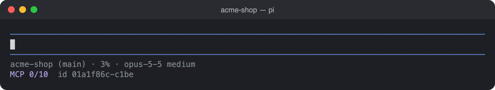

# pi-qol

[](LICENSE) [](https://github.com/badlogic/pi-mono)

Quality-of-life extensions for the [pi coding agent](https://github.com/badlogic/pi-mono): always know what a conversation is about, see only the footer you use, and paste screenshots the way you do in a chat app.



## Features

| Extension          | What it does                                                                                                  |
| ------------------ | ------------------------------------------------------------------------------------------------------------- |
| **session-header** | A title and a short summary of the conversation, pinned to the top of the screen and kept up to date          |
| **compact-footer** | A two-line footer: folder and branch, context used, model, then the session id and other extensions' status   |
| **image-paste**    | `Cmd+V` or `Ctrl+V` a screenshot: a short marker in the draft, a thumbnail above the editor, sent as an image |

Each one works on its own. Turn off the ones you don't want (see [Choose extensions](#choose-extensions)).

## Install

```bash
pi install git:github.com/rafae2k/pi-qol
```

Then run `/reload` in any open session. To try it for one session without installing:

```bash
pi -e git:github.com/rafae2k/pi-qol
```

Requires Node 24 or newer. Built and tested on pi 1.5.2 on macOS.

## session-header

You come back to a terminal tab and can't remember what that conversation was about. The header tells you, without scrolling.

- After the first reply, a model writes a title and a summary: the goal, where it stands, what is left.
- It refreshes every 3 of your messages (configurable), on the side, without slowing the conversation.
- The summary is sized to fit 3 rows at your terminal's width, and the title also goes to the terminal tab.
- It is saved in the session and comes back when you resume. It never enters the model's context.
- The title names the session in `/resume`, unless you named it yourself with `/name`.

| Command    | What it does                                                   |
| ---------- | -------------------------------------------------------------- |
| `/summary` | Refresh the summary now                                        |
| `/id`      | Copy `pi --session <id>` to the clipboard, to reopen this chat |

The header is an overlay: it stays on top while the transcript scrolls under it, so it covers the first 4 rows of the visible transcript.

## compact-footer



pi's default footer shows token and cache counters on every screen. This one keeps what you act on:

- **Line 1:** folder and git branch · share of the context window used · model and thinking level.
- **Line 2:** status from other extensions, such as the session id from session-header or the MCP count.

The session id is shortened to its first 13 characters. pi ids are UUIDv7, so that prefix is the creation millisecond and is unique in practice, and `pi --session` accepts a prefix.

## image-paste

![A pasted screenshot shown as a thumbnail above the editor, with an [image 1] marker in the draft](docs/image-paste.png)

Terminals paste text, so `Cmd+V` on a screenshot pastes its file path. Screenshot tools that put both a file and an image on the clipboard (CleanShot, Finder copy) make pi's own `Ctrl+V` paste the path too.

| You do                                  | You get                                                           |
| --------------------------------------- | ----------------------------------------------------------------- |
| `Cmd+V` of an image file path           | `[image 1]` in the draft and a thumbnail above the editor         |
| `Ctrl+V` with an image on the clipboard | Same; an image without a file is saved to a temp file first       |
| `Ctrl+V` with text on the clipboard     | The text, as usual                                                |
| `Backspace` right after a marker        | Removes the whole marker and its thumbnail                        |
| Send                                    | Each marker, and any image path typed in the message, is attached |

Images are resized to at most 2000 px per side before sending, like pi does.

**Thumbnails need a terminal that draws images**, such as [Ghostty](https://ghostty.org), Kitty, WezTerm or iTerm2. In Terminal.app you still get the marker and the attachment, without the picture.

## Configuration

Settings go under the `pi-qol` key of pi's `settings.json` (`~/.pi/agent/settings.json`, or `.pi/settings.json` in a project):

```json
{
  "pi-qol": {
    "summaryModel": "anthropic/claude-haiku-4-5",
    "summaryEvery": 3,
    "summaryLanguage": "English"
  }
}
```

| Key               | Default                   | Meaning                                                            |
| ----------------- | ------------------------- | ------------------------------------------------------------------ |
| `summaryModel`    | the session's model       | `provider/model-id` that writes summaries. A small model is plenty |
| `summaryEvery`    | `3`                       | Your messages between automatic refreshes                          |
| `summaryLanguage` | the language you write in | Language of the title and summary                                  |

### Choose extensions

Load only some of them with pi's package filters:

```json
{
  "packages": [{ "source": "git:github.com/rafae2k/pi-qol", "extensions": ["!extensions/image-paste.ts"] }]
}
```

Or run `pi config` and toggle them.

## Limitations

- **image-paste reads the clipboard on macOS only.** On Linux and Windows, `Ctrl+V` stays pi's own, and pasting an image path still becomes a marker with a thumbnail.
- pi does not tell extensions where the cursor is, so one `Backspace` removes a marker only when the cursor is at the end of the draft and was not moved since the paste. Otherwise delete it like any text.
- [pi-image-tools](https://www.npmjs.com/package/pi-image-tools) uses `Alt+V` and `Ctrl+Alt+V` by default and works alongside. If you bound it to `Ctrl+V`, pick one of the two.
- Each summary is one extra model call, every few messages. Point `summaryModel` at a small model to keep it cheap.

## How the images were made

The screenshots are real pi sessions in a demo repository, captured from a pseudo-terminal and drawn by [`scripts/render-demos.py`](scripts/render-demos.py). The terminal library behind the capture cannot draw inline images, so in the image-paste screenshot the thumbnail is placed into the rows pi reserved for it.

## Contributing

See [CONTRIBUTING.md](CONTRIBUTING.md). Issues and pull requests are welcome.

## License

[MIT](LICENSE)
